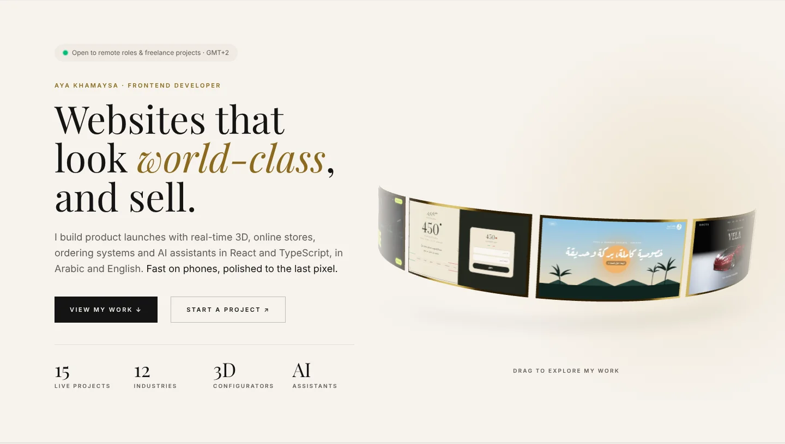

# Aya Khamaysa · Frontend Developer

**Websites that look world-class, and sell.**
Product launches with real-time 3D, online stores, ordering systems and AI assistants, in Arabic and English.

**Live:** [aya-khamaysa-portfolio.vercel.app](https://aya-khamaysa-portfolio.vercel.app) · [LinkedIn](https://www.linkedin.com/in/ayakhamaysa)



## Highlights

- **3D hero:** a ring of curved screens showing 10 live projects, built with React Three Fiber. Drag to spin it, hover to see a project's name, click to open the live site.
- **Fast first paint:** the text shows right away; three.js loads in its own chunk afterwards, and drawing pauses when the hero is scrolled out of view.
- **Safe on every device:** if WebGL is off, a still layout of project screenshots is shown instead.
- **Data-driven:** every project card comes from one file, `src/data/projects.js`.
- **Mobile first,** with reduced motion respected for visitors who turn animations off.

## Selected work

| Project | What it shows | Stack |
| --- | --- | --- |
| [NOCTA VELA](https://nocta-vela.vercel.app) | 3D electric car launch and live configurator | React Three Fiber, glTF |
| [ORIEL Heritage 40](https://oriel-watch-gamma.vercel.app) | Luxury watch modelled in code, exploded view | Three.js, procedural 3D |
| [AURA ONE](https://aura-headphones-nu.vercel.app) | Headphones launch with live recoloring | Three.js, GLSL shaders |
| [NUVO Wallet](https://nuvo-wallet.vercel.app) | Fintech app launch with a 3D phone | R3F, canvas textures |
| [MASKAN](https://maskan-real-estate.vercel.app) | Dubai homes on an interactive map | **TypeScript (strict)**, Leaflet |
| [MIZU Sushi](https://mizu-roan.vercel.app) | Bilingual menu with an AI chef | Gemini API, serverless |
| [APEX Gym](https://apex-six-jet.vercel.app) | Gym site with an AI coach and booking | Gemini API, structured output |
| [Glossy](https://glossybyn.netlify.app) | Live cosmetics store for a real client | Supabase, PostgreSQL |

All 15 projects are on the [live portfolio](https://aya-khamaysa-portfolio.vercel.app/#work).

## Built with

React 19 · Vite · Tailwind CSS v4 · Three.js · React Three Fiber · drei · Framer Motion

## Run locally

```bash
npm install
npm run dev
```

## Add a project

Add a new object to `src/data/projects.js` and its screenshot (1200 × 630) to `public/projects`.
To show it on the 3D ring too, add its name to `featured` in `src/components/Hero.jsx`.

---

Designed & built by Aya Khamaysa · [One Click](https://www.instagram.com/oneclick.ps)
